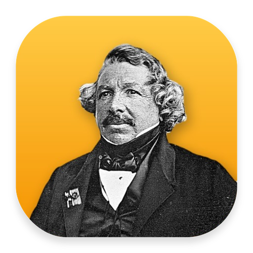

<div align="center">
  <a href="https://getnodalia.com">
    
  </a>
  <br><br>
  
  <h1>Luz</h1>
  <p><strong>The RAW developer and photo library of the Nodalia suite.</strong></p>

  <p>
    
    
    
  </p>

  <p>
    <a href="#overview">Overview</a> ·
    <a href="#build-and-run">Build</a> ·
    <a href="#project-status">Status</a> ·
    <a href="#the-nodalia-suite">Suite</a> ·
    <a href="#license">License</a>
  </p>
</div>

---

## Overview

**Luz** is the RAW developer and photo library of [Nodalia](https://getnodalia.com): a native app written in Rust,
with no account and no cloud. It runs on Linux, macOS and Windows.

> [!IMPORTANT]
> **Luz is at an early stage.** Keep a copy of your original photos. Luz edits without touching them,
> but a backup is wise.

## Download

Luz 0.1.0 and later are on the [releases page](https://github.com/getnodalia/luz/releases/latest) and on
[getnodalia.com/luz](https://getnodalia.com/luz/): an AppImage, `.deb`, `.rpm` and `.tar.gz` for Linux x86_64,
a DMG for macOS (Apple Silicon and Intel) and an MSI or portable zip for Windows x64. The macOS DMG is not
signed or notarized: the first time, right-click Luz in Applications and choose **Open**.

## Build and run

You need a recent stable Rust toolchain.

```bash
git clone https://github.com/getnodalia/luz.git
cd luz
cargo run --release -p luz
```

## Project status

| Area | State |
|---|---|
| Package and binary names | Done: the desktop binary is called `luz` |
| App icon | Done: portrait of Louis Daguerre |
| Nodalia interface | Done: rounded islands, Nodalia window controls on Linux (native on macOS and Windows), flat Nodalia icons, light and dark theme in Preferences, menu in the desktop's top bar on Linux |
| Shared interface resources | The Nodalia Design components and icons are shared with the other Nodalia apps |
| Installable packages | Linux, macOS and Windows, from 0.1.0 |

## App icon

Nodalia app icons are black-and-white portraits of historical figures over the app colour.
Luz's is Louis Daguerre, a pioneer of photography. Provenance and licence are in [`assets/app-icon/`](assets/app-icon/).

## The Nodalia suite

Luz is one of the applications of [Nodalia](https://getnodalia.com), an independent software
project developed in public by [Daniel Miguel Tejedor](https://danielmigueltejedor.com).

## License

`MIT OR Apache-2.0`. See [`LICENSE-MIT`](LICENSE-MIT), [`LICENSE-APACHE`](LICENSE-APACHE) and
[`NOTICE`](NOTICE).
